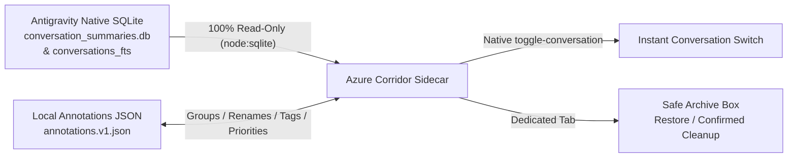

<div align="center">

<p>🌐 &nbsp; <a href="README.md">简体中文</a> &nbsp;·&nbsp; <strong>English</strong></p>

<picture>
  <source media="(prefers-color-scheme: dark)" srcset="assets/readme/hero-en-dark.svg">
  
</picture>

<p>
  <a href="https://github.com/A16Nights/antigravity-azure-corridor/releases"></a>
  <a href="https://github.com/A16Nights/antigravity-azure-corridor/stargazers"></a>
  
  
  
  <a href="./LICENSE"></a>
</p>

<p>
  <strong>100% read-only FTS5 conversation search, custom project groups, workspace aggregation, P1–P5 priorities, and a safe Archive Box</strong>
</p>

<p>
  <a href="#preview">🖼️ Preview</a> &nbsp;·&nbsp; <a href="#features">✨ Features</a> &nbsp;·&nbsp; <a href="#architecture">🧩 Architecture</a> &nbsp;·&nbsp; <a href="#installation">🚀 Quick Start</a> &nbsp;·&nbsp; <a href="#storage">📂 Storage</a> &nbsp;·&nbsp; <a href="#azure-suite">🌌 Azure Suite</a>
</p>

</div>

Native conversation management workbench (Sidecar + standalone Web UI) for **Google Antigravity**. Queries Antigravity's local SQLite databases (`conversation_summaries.db` & `conversations_fts`) strictly in **read-only mode** while persisting all custom groups, renames, tags, notes, and archive states in a separate local JSON file—**zero risk to native Protobuf data**.

<table>
<tr>
<td width="50%" valign="top">
<h4>⚡ Instant Switch & FTS5 Search</h4>
Queries native <code>conversations_fts</code> via built-in <code>node:sqlite</code> in milliseconds across titles, full bodies, code snippets, and notes; click any title to switch natively.
</td>
<td width="50%" valign="top">
<h4>🗂️ Dual Grouping & Archive Sync</h4>
Combine custom project groups with automatic native Workspace detection, plus automatic syncing and badge display for officially archived conversations.
</td>
</tr>
<tr>
<td width="50%" valign="top">
<h4>🏷️ Inline Rename, Priorities & Notes</h4>
Inline title editing with customizable highlight colors, pin/star/watch-later flags, P1–P5 priority badges, multi-tags, and rich notes.
</td>
<td width="50%" valign="top">
<h4>📦 Whole-Card Batch & Archive Box</h4>
Select entire cards in Batch Mode to move, prioritize, star, tag, or archive in bulk; main view archives safely without destructive deletes.
</td>
</tr>
</table>

<h2 id="preview">
<picture>
  <source media="(prefers-color-scheme: dark)" srcset="assets/readme/sec-preview-en-dark.svg">
  
</picture>
</h2>

<p align="center">
  <a href="assets/readme/preview-panel.png"></a>
  <br><strong>Azure Corridor · FTS5 Full-Text Search &amp; Conversation Workbench</strong>
  <br><sub>Instant FTS5 search, group/tag/sort filters, official archive badges, inline rename, pin/star/watch-later &amp; safe archiving</sub>
</p>

<h2 id="features">
<picture>
  <source media="(prefers-color-scheme: dark)" srcset="assets/readme/sec-features-en-dark.svg">
  
</picture>
</h2>

### 1. Native Instant Switching & Multi-Dimensional FTS5 Search
- **One-Click Native Switching**: Jumps directly to any conversation via Antigravity's native `toggle-conversation` protocol, paired with a quick Copy Session ID button.
- **Full-Text FTS5 Search**: Uses Node.js built-in `node:sqlite` to search Antigravity's native `conversations_fts` index across titles, message bodies, code snippets, tags, and notes in milliseconds.
- **Rich Filters & Sorting**: Filter by All, `★ Starred`, `⏱ Watch Later`, `P1–P5 Priority`, `Officially Archived`, or `Ungrouped`; sort by Recent Activity, Created Time, Priority, or Title.

### 2. Dual Grouping (Custom Groups + Native Workspaces)
- **Custom Project Groups**: Create, rename, archive, and delete your own cross-workspace topic groups without affecting Antigravity's native workspaces.
- **Automatic Workspace Detection**: Parses each conversation's workspace path for instant workspace filtering.
- **Official Archive Sync**: Detects officially archived conversations, renders a clear **`Officially Archived`** badge, and offers a dedicated filter toggle.

### 3. Single-Session Organization & Annotation
- **Inline Rename & Highlight**: Click `✎` to rename inline (`Enter`/blur saves, `Esc` cancels); renamed titles highlight automatically with 7 color presets or a free color picker.
- **Pin / Star / Watch Later**: Pin critical threads or flag them as `★ Starred` / `⏱ Watch Later`.
- **P1–P5 Priorities, Tags & Notes**: Assign color-coded priority levels, multiple searchable tags, and persistent progress notes.

### 4. Batch Management & Safe Archive Box
- **Whole-Card Selection**: In Batch Mode, click anywhere on a card to select (or Select All filtered results) to batch-move, change priority, toggle stars, add/remove tags, or archive.
- **Archive-First Safety**: Main lists only archive rather than hard-deleting; archived conversations and groups live in the dedicated **Archive Box** tab for one-click restore or double-confirmed cleanup.

### 5. Unified Azure Suite UI
- **Neko Glass UI & Shared Theme Center**: Dark/light themes, custom glass dropdowns (`AzureSelect`), 6 official color presets + dual custom pickers + 4 shared slots, sidebar toggle, standalone `Web UI`, and GitHub Release update checks.

<h2 id="architecture">
<picture>
  <source media="(prefers-color-scheme: dark)" srcset="assets/readme/sec-arch-en-dark.svg">
  
</picture>
</h2>



<h2 id="installation">
<picture>
  <source media="(prefers-color-scheme: dark)" srcset="assets/readme/sec-install-en-dark.svg">
  
</picture>
</h2>

> **Prerequisite**: **Node.js >= 22.0.0** (zero third-party npm dependencies, pure native ESM).

### Option 1 · Let Antigravity Install It for You (Recommended)

Copy and send the following prompt directly to Antigravity:

> Please clone `https://github.com/A16Nights/antigravity-azure-corridor.git` into my Antigravity global plugins directory as `azure-corridor`, verify the directory structure, and tell me once it is ready so I can press `Ctrl+R` to reload.

### Option 2 · Manual Git Clone

```powershell
# Windows (PowerShell)
git clone https://github.com/A16Nights/antigravity-azure-corridor.git "$env:USERPROFILE\.gemini\config\plugins\azure-corridor"

# macOS / Linux
git clone https://github.com/A16Nights/antigravity-azure-corridor.git ~/.gemini/config/plugins/azure-corridor
```

Restart or reload Antigravity (`Ctrl+R`), enable **Azure Corridor** in **Plugins**, and open it from the left sidebar or right-hand panel.

<h2 id="storage">
<picture>
  <source media="(prefers-color-scheme: dark)" srcset="assets/readme/sec-storage-en-dark.svg">
  
</picture>
</h2>

<details open>
<summary><strong>Click to inspect local data paths & shared Azure Suite configs</strong></summary>

<br>

- **Groups, Renames, Tags, Notes & Archive State**: `~/.gemini/azure-corridor/annotations.v1.json`
- **Azure Suite Sidebar Visibility**: `~/.gemini/azure-sidebar-nav.json`
- **Shared Azure Suite Theme**: `~/.gemini/azure-theme.json`

> Never modifies or pollutes any native Antigravity database file.

</details>

<h2 id="azure-suite">
<picture>
  <source media="(prefers-color-scheme: dark)" srcset="assets/readme/sec-suite-en-dark.svg">
  
</picture>
</h2>

All **8 Azure Suite plugins** share a unified **Neko Glass UI**, synchronized **Azure Theme Center** (`~/.gemini/azure-theme.json`), and customizable **Sidebar Navigation Hub** (`~/.gemini/azure-sidebar-nav.json`):

| Plugin | Repository | Core Capability |
| --- | --- | --- |
| ✦ **External Orchestrator** | [antigravity-external-orchestrator](https://github.com/A16Nights/antigravity-external-orchestrator) | Multi-provider external worker routing, custom profiles, circuit breaker & live monitoring |
| 🪐 **Azure Orbit** | [antigravity-azure-orbit](https://github.com/A16Nights/antigravity-azure-orbit) | Mount external LLM APIs directly into Antigravity's native bottom-left model selector |
| 🧭 **Azure Compass** | [antigravity-azure-compass](https://github.com/A16Nights/antigravity-azure-compass) | Agent mode presets, live context telemetry with auto /compact & Azure Suite sidebar hub |
| 🏛️ **Azure Corridor** &nbsp;`✦ This Repo` | [antigravity-azure-corridor](https://github.com/A16Nights/antigravity-azure-corridor) | Read-only FTS5 conversation search, custom project groups, priority tags & safe archive |
| 🌌 **Lanxi Memory** | [antigravity-lanxi-memory](https://github.com/A16Nights/antigravity-lanxi-memory) | 5-layer Markdown cognitive graph, CJK FTS5, tidal forgetting curves & starfield UI |
| 💎 **Soul.md Studio** | [antigravity-soul-md](https://github.com/A16Nights/antigravity-soul-md) | Hot-swappable persona cards, workspace binding, external-model anchor & layered memory |
| 💭 **Think-ZH** | [antigravity-think-zh](https://github.com/A16Nights/antigravity-think-zh) | Simplified Chinese / English reasoning switcher with dual-channel anti-drift hooks |
| 🔮 **Azure Prism** | [antigravity-azure-prism](https://github.com/A16Nights/antigravity-azure-prism) | Native MCP App Chain-of-Thought viewer with keyless zero-token MT & LLM translation |

---

<div align="center">

📄 Released under the <a href="./LICENSE"><strong>MIT License</strong></a> · Crafted for <strong>Google Antigravity</strong>

</div>
