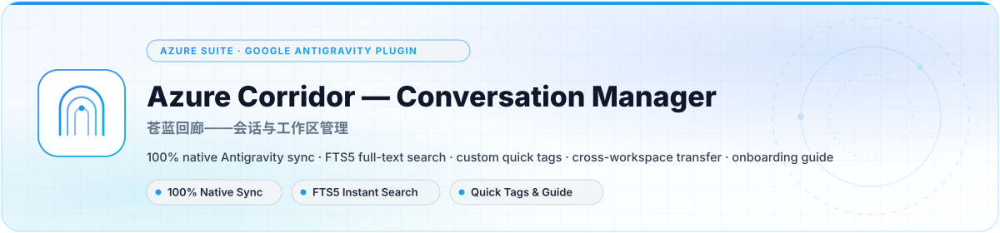
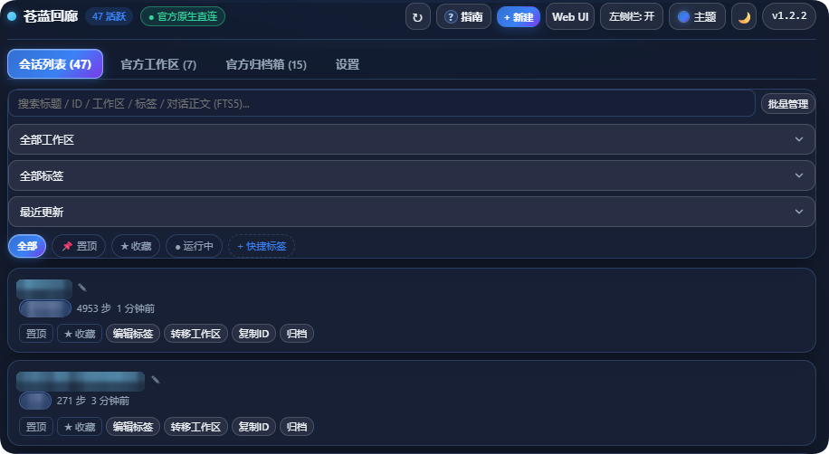
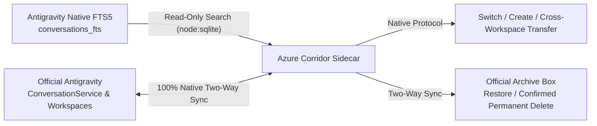

<div align="center">

<p>🌐 &nbsp; <a href="README.md">简体中文</a> &nbsp;·&nbsp; <strong>English</strong></p>

<picture>
  <source media="(prefers-color-scheme: dark)" srcset="assets/readme/hero-en-dark.svg">
  
</picture>

<p>
  <a href="https://github.com/A16Nights/antigravity-azure-corridor/releases"></a>
  <a href="https://github.com/A16Nights/antigravity-azure-corridor/stargazers"></a>
  
  
  
  <a href="./LICENSE"></a>
</p>

<p>
  <strong>100% native Antigravity 2.35+ ConversationService &amp; Workspace manager · FTS5 full-text search · cross-workspace transfer · native tags, groups &amp; archive sync</strong>
</p>

<p>
  <a href="#preview">🖼️ Preview</a> &nbsp;·&nbsp; <a href="#features">✨ Features</a> &nbsp;·&nbsp; <a href="#architecture">🧩 Architecture</a> &nbsp;·&nbsp; <a href="#installation">🚀 Quick Start</a> &nbsp;·&nbsp; <a href="#storage">📂 Storage</a> &nbsp;·&nbsp; <a href="#azure-suite">🌌 Azure Suite</a>
</p>

</div>

Pure-native conversation & workspace workbench (Sidecar + standalone Web UI) for **Google Antigravity 2.35+**. Syncs 100% directly with Antigravity's official `ConversationService` and workspace configuration while querying native `conversations_fts` via `node:sqlite` for millisecond full-text search, workspace browsing & creation, pinning/starring, native tags & groups, official Archive Box, batch actions, cross-workspace transfer, and official permanent deletion.

<table>
<tr>
<td width="50%" valign="top">
<h4>⚡ Instant Switch & FTS5 Search</h4>
Queries native <code>conversations_fts</code> via built-in <code>node:sqlite</code> in milliseconds across titles, full bodies, and code snippets; click any session to switch natively.
</td>
<td width="50%" valign="top">
<h4>🗂️ 100% Official Native Sync</h4>
Connects directly to Antigravity's <code>ConversationService</code> and workspaces to stay in full two-way sync with native groups, tags, pins, stars, and archive states.
</td>
</tr>
<tr>
<td width="50%" valign="top">
<h4>🔀 Create &amp; Cross-Workspace Transfer</h4>
Spin up new conversations inside any official workspace or transfer an existing conversation to another workspace to continue seamlessly.
</td>
<td width="50%" valign="top">
<h4>📦 Batch Actions &amp; Official Archive Box</h4>
Batch-group, tag, star, archive, restore, or perform double-confirmed official permanent deletion in full sync with Antigravity's native sidebar.
</td>
</tr>
</table>

<h2 id="preview">
<picture>
  <source media="(prefers-color-scheme: dark)" srcset="assets/readme/sec-preview-en-dark.svg">
  
</picture>
</h2>

<p align="center">
  <a href="assets/readme/preview-panel.png"></a>
  <br><strong>Azure Corridor · FTS5 Full-Text Search &amp; Conversation Workbench</strong>
  <br><sub>Instant FTS5 search, group/tag/sort filters, official archive badges, inline rename, pin/star/watch-later &amp; safe archiving</sub>
</p>

<h2 id="features">
<picture>
  <source media="(prefers-color-scheme: dark)" srcset="assets/readme/sec-features-en-dark.svg">
  
</picture>
</h2>

### 1. Native Instant Switching & Multi-Dimensional FTS5 Search
- **One-Click Native Switching**: Jumps directly to any conversation via Antigravity's native `toggle-conversation` protocol, paired with a quick Copy Session ID button.
- **Full-Text FTS5 Search**: Uses Node.js built-in `node:sqlite` to search Antigravity's native `conversations_fts` index across titles, message bodies, and code snippets in milliseconds.
- **Rich Filters & Sorting**: Filter and sort across All, Pinned, `★ Starred`, native Groups, native Tags, official Workspaces, and Official Archive status.

### 2. 100% Official Native Conversation & Workspace Sync
- **Direct `ConversationService` Integration**: Pinning, starring, inline renaming, native tags, official groups, archiving, and restoring write through official Antigravity APIs—100% synchronized with the native sidebar.
- **Official Workspaces & New Conversations**: Automatically reads configured official workspaces for aggregated browsing and lets you start new conversations directly inside any chosen workspace.

### 3. Cross-Workspace Transfer & Batch Management
- **Cross-Workspace Transfer**: Transfer any conversation to another workspace and keep working without rebuilding context from scratch.
- **Batch Actions & Official Archive Box**: Select multiple sessions to batch-group, tag, star, archive, restore, or execute double-confirmed official permanent deletion.

### 4. Unified Azure Suite UI
- **Neko Glass UI & Shared Theme Center**: Dark/light themes, custom glass dropdowns (`AzureSelect`), 6 official color presets + dual custom pickers + 4 shared slots, sidebar toggle, standalone `Web UI`, and GitHub Release update checks.

<h2 id="architecture">
<picture>
  <source media="(prefers-color-scheme: dark)" srcset="assets/readme/sec-arch-en-dark.svg">
  
</picture>
</h2>



<h2 id="installation">
<picture>
  <source media="(prefers-color-scheme: dark)" srcset="assets/readme/sec-install-en-dark.svg">
  
</picture>
</h2>

> **Prerequisite**: **Node.js >= 22.0.0** (zero third-party npm dependencies, pure native ESM).

### Option 1 · Let Antigravity Install It for You (Recommended)

Copy and send the following prompt directly to Antigravity:

> Please clone `https://github.com/A16Nights/antigravity-azure-corridor.git` into my Antigravity global plugins directory as `azure-corridor`, verify the directory structure, and tell me once it is ready so I can press `Ctrl+R` to reload.

### Option 2 · Manual Git Clone

```powershell
# Windows (PowerShell)
git clone https://github.com/A16Nights/antigravity-azure-corridor.git "$env:USERPROFILE\.gemini\config\plugins\azure-corridor"

# macOS / Linux
git clone https://github.com/A16Nights/antigravity-azure-corridor.git ~/.gemini/config/plugins/azure-corridor
```

Restart or reload Antigravity (`Ctrl+R`), enable **Azure Corridor** in **Plugins**, and open it from the left sidebar or right-hand panel.

<h2 id="storage">
<picture>
  <source media="(prefers-color-scheme: dark)" srcset="assets/readme/sec-storage-en-dark.svg">
  
</picture>
</h2>

<details open>
<summary><strong>Click to inspect local data paths & shared Azure Suite configs</strong></summary>

<br>

- **Corridor UI Preferences**: `~/.gemini/azure-corridor/` (all session metadata, groups, tags, and archive state sync directly with Antigravity's native storage)
- **Azure Suite Sidebar Visibility**: `~/.gemini/azure-sidebar-nav.json`
- **Shared Azure Suite Theme**: `~/.gemini/azure-theme.json`

</details>

<h2 id="azure-suite">
<picture>
  <source media="(prefers-color-scheme: dark)" srcset="assets/readme/sec-suite-en-dark.svg">
  
</picture>
</h2>

All **9 Azure Suite plugins** share a unified **Neko Glass UI**, synchronized **Azure Theme Center** (`~/.gemini/azure-theme.json`), and customizable **Sidebar Navigation Hub** (`~/.gemini/azure-sidebar-nav.json`):

| Plugin | Repository | Core Capability |
| --- | --- | --- |
| ✦ **External Orchestrator** | [antigravity-external-orchestrator](https://github.com/A16Nights/antigravity-external-orchestrator) | Multi-provider external worker routing, custom profiles, circuit breaker & live monitoring |
| 🪐 **Azure Orbit** | [antigravity-azure-orbit](https://github.com/A16Nights/antigravity-azure-orbit) | Mount external LLM APIs directly into Antigravity's native bottom-left model selector |
| 🧭 **Azure Compass** | [antigravity-azure-compass](https://github.com/A16Nights/antigravity-azure-compass) | Agent mode presets, live context telemetry with auto /compact & Azure Suite sidebar hub |
| 🏛️ **Azure Corridor** &nbsp;`✦ This Repo` | [antigravity-azure-corridor](https://github.com/A16Nights/antigravity-azure-corridor) | Read-only FTS5 conversation search, custom project groups, priority tags & safe archive |
| 🌌 **Lanxi Memory** | [antigravity-lanxi-memory](https://github.com/A16Nights/antigravity-lanxi-memory) | 5-layer Markdown cognitive graph, CJK FTS5, tidal forgetting curves & starfield UI |
| 💎 **Soul.md Studio** | [antigravity-soul-md](https://github.com/A16Nights/antigravity-soul-md) | Hot-swappable persona cards, workspace binding, external-model anchor & layered memory |
| 💭 **Think-ZH** | [antigravity-think-zh](https://github.com/A16Nights/antigravity-think-zh) | Simplified Chinese / English reasoning switcher with dual-channel anti-drift hooks |
| 🔮 **Azure Prism** | [antigravity-azure-prism](https://github.com/A16Nights/antigravity-azure-prism) | Native MCP App Chain-of-Thought viewer with keyless zero-token MT & LLM translation |
| 🪄 **Azure Wand** | [antigravity-azure-wand](https://github.com/A16Nights/antigravity-azure-wand) | Low-intrusion Windows desktop & web automation with 15-state independent AI cursor, pack gallery & importer |

---

<div align="center">

📄 Released under the <a href="./LICENSE"><strong>MIT License</strong></a> · Crafted for <strong>Google Antigravity</strong>

</div>
