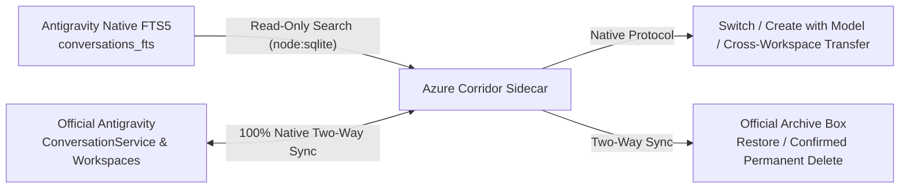
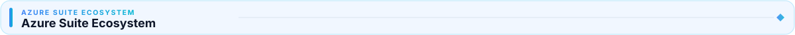

<div align="center">

<p>🌐 &nbsp; <a href="README.md">简体中文</a> &nbsp;·&nbsp; <strong>English</strong></p>

<picture>
  <source media="(prefers-color-scheme: dark)" srcset="assets/readme/hero-en-dark.svg">
  
</picture>

<p>
  <a href="https://github.com/A16Nights/antigravity-azure-corridor/releases"></a>
  <a href="https://github.com/A16Nights/antigravity-azure-corridor/stargazers"></a>
  
  
  
  <a href="./LICENSE"></a>
</p>

<p>
  <strong>Azure Corridor — Conversation &amp; Workspace Manager · 100% Native Sync · FTS5 Full-Text Search · Custom Quick Tags · Cross-Workspace Transfer · Interactive Onboarding</strong>
</p>

<p>
  <a href="#preview">🖼️ Preview</a> &nbsp;·&nbsp; <a href="#features">✨ Features</a> &nbsp;·&nbsp; <a href="#architecture">🧩 Architecture</a> &nbsp;·&nbsp; <a href="#installation">🚀 Quick Start</a> &nbsp;·&nbsp; <a href="#storage">📂 Storage</a> &nbsp;·&nbsp; <a href="#azure-suite">🌌 Azure Suite</a>
</p>

</div>

**Azure Corridor — Conversation & Workspace Manager** is a pure-native conversation and workspace workbench (Sidecar + standalone Web UI) for **Google Antigravity 2.35+**. It connects 100% directly to Antigravity's official `ConversationService` and workspace configuration while querying native `conversations_fts` via `node:sqlite` for millisecond full-text search, workspace browsing & creation, a customizable Quick Tag filter bar, live official model selection (defaulting to your current active model), cross-workspace transfer, batch management, the official Archive Box, and an interactive 5-step first-run onboarding guide.

<table>
<tr>
<td width="50%" valign="top">
<h4>⚡ Instant Switch &amp; FTS5 Search</h4>
Queries native <code>conversations_fts</code> via built-in <code>node:sqlite</code> in milliseconds across titles, tags, bodies, and code snippets; click any title to switch natively.
</td>
<td width="50%" valign="top">
<h4>🏷️ 100% Native Sync &amp; Custom Quick Tags</h4>
Connects directly to Antigravity's <code>ConversationService</code> for pins, stars, native tags, and archive states; pin your favorite <code>#tags</code> right onto the top quick-filter bar.
</td>
</tr>
<tr>
<td width="50%" valign="top">
<h4>🔀 Live Model Picker &amp; Cross-Workspace Transfer</h4>
Fetches live official Antigravity models and automatically carries over the current conversation's model by default; transfer any session across workspaces seamlessly.
</td>
<td width="50%" valign="top">
<h4>🧭 5-Step Interactive Guide &amp; Official Archive Box</h4>
First-run interactive walkthrough with live UI control spotlighting (reopen anytime via <code>? Guide</code>); batch actions and official archive sync with double-confirmed deletion.
</td>
</tr>
</table>

<h2 id="preview">
<picture>
  <source media="(prefers-color-scheme: dark)" srcset="assets/readme/sec-preview-en-dark.svg">
  
</picture>
</h2>

<p align="center">
  <a href="assets/readme/preview-panel.png"></a>
  <br><strong>Azure Corridor — Conversation &amp; Workspace Manager · Main Workbench</strong>
  <br><sub>Instant FTS5 full-text search, workspace/tag/sort filters, customizable Quick Tag pills alongside All / Pinned / Starred / Running, inline tag editing &amp; cross-workspace transfer</sub>
</p>

<p align="center">
  <a href="assets/readme/preview-onboarding.png"></a>
  <br><strong>First-Run 5-Step Interactive Onboarding Guide</strong>
  <br><sub>Step-by-step walkthrough with real-UI spotlight highlighting and a floating return bar, persisted across restarts and reopenable anytime from the topbar <code>? Guide</code> button</sub>
</p>

<h2 id="features">
<picture>
  <source media="(prefers-color-scheme: dark)" srcset="assets/readme/sec-features-en-dark.svg">
  
</picture>
</h2>

### 1. Native Instant Switching, FTS5 Full-Text Search & Custom Quick Tag Bar
- **One-Click Native Switching**: Jumps directly to any conversation via Antigravity's native `toggle-conversation` protocol, paired with inline rename and quick Copy ID buttons.
- **Full-Text FTS5 Search**: Uses Node.js built-in `node:sqlite` to search Antigravity's native `conversations_fts` index across titles, tags, message bodies, and code snippets in milliseconds.
- **Customizable Quick Tag Filter Bar**: Click **`+ Quick Tags`** at the end of the `All / Pinned / Starred / Running` filter row to pin your most-used native tags (or create new ones) as one-click filter pills, combinable with Pinned or Starred; clicking any `#tag` badge on a session card also filters by that tag immediately.

### 2. 100% Official Native Conversation & Workspace Sync
- **Direct `ConversationService` Integration**: Pinning, starring, inline renaming, native tags, archiving, and restoring write directly through official Antigravity APIs—100% synchronized with the native sidebar. Focused around clean **Workspace + Tag** organization (legacy group IDs stay tucked inside a collapsed compatibility drawer in the edit dialog).
- **Official Workspaces & New Conversations**: Automatically reads configured official workspaces for aggregated browsing and lets you start new conversations directly inside any chosen workspace.

### 3. Enhanced Cross-Workspace Transfer, Zero-LLM Rescue Brief & Current-Model Default
- **Enhanced Cross-Workspace Transfer**: Transfer any conversation to another workspace with title, tags, pin/star states, summary, and an auto-extracted zero-LLM progress digest (recent intents, modified files, latest check, and last reply) preserved, plus optional auto-archiving of the original session.
- **Zero-LLM Redacted Rescue Brief (`🛟 Rescue Brief`)**: Extract a redacted Markdown handoff brief from any active or archived session in `<20ms` (model, actual tokens/cache hit rate, modified files, recent intents & progress, with common secrets automatically scrubbed), ready to copy or launch straight into a new continuation session.
- **Live Official Model Picker & Current-Model Default**: Both New Conversation and Cross-Workspace Transfer fetch the live list of official Antigravity models (with tier fallbacks), and the default option automatically detects and carries over the official model currently used by the source or active conversation instead of silently dropping back to `flash`.
- **Batch Actions & Official Archive Box**: Select multiple sessions to batch-pin, star, tag, archive, restore, or execute double-confirmed official permanent deletion.

### 4. First-Run Interactive Onboarding & Unified Azure Suite UI
- **5-Step Interactive Onboarding (`? Guide`)**: Automatically introduces core workflows on first launch with one-click live UI spotlighting and a floating return bar; completion state persists locally across sidecar port restarts and can be revisited anytime via **`? Guide`**.
- **Neko Glass UI & Shared Theme Center**: Dark/light themes, custom glass dropdowns (`AzureSelect`), 6 official color presets + dual custom pickers + 4 shared slots, sidebar toggle, standalone `Web UI`, and GitHub Release update checks.

<h2 id="architecture">
<picture>
  <source media="(prefers-color-scheme: dark)" srcset="assets/readme/sec-arch-en-dark.svg">
  
</picture>
</h2>



<h2 id="installation">
<picture>
  <source media="(prefers-color-scheme: dark)" srcset="assets/readme/sec-install-en-dark.svg">
  
</picture>
</h2>

> **Prerequisite**: **Node.js >= 22.0.0** (zero third-party npm dependencies, pure native ESM).

### Option 1 · Let Antigravity Install It for You (Recommended)

Copy and send the following prompt directly to Antigravity:

> Please clone `https://github.com/A16Nights/antigravity-azure-corridor.git` into my Antigravity global plugins directory as `azure-corridor`, verify the directory structure, and tell me once it is ready so I can press `Ctrl+R` to reload.

### Option 2 · Manual Git Clone

```powershell
# Windows (PowerShell)
git clone https://github.com/A16Nights/antigravity-azure-corridor.git "$env:USERPROFILE\.gemini\config\plugins\azure-corridor"

# macOS / Linux
git clone https://github.com/A16Nights/antigravity-azure-corridor.git ~/.gemini/config/plugins/azure-corridor
```

Restart or reload Antigravity (`Ctrl+R`), enable **Azure Corridor** in **Plugins**, and open it from the left sidebar or right-hand panel.

<h2 id="storage">
<picture>
  <source media="(prefers-color-scheme: dark)" srcset="assets/readme/sec-storage-en-dark.svg">
  
</picture>
</h2>

<details open>
<summary><strong>Click to inspect local data paths &amp; shared Azure Suite configs</strong></summary>

<br>

- **Corridor UI Preferences (Quick Tags)**: `~/.gemini/azure-corridor/prefs.json` (all session metadata, tags, and archive state sync directly with Antigravity's native storage)
- **First-Run Onboarding State**: `~/.gemini/azure-onboarding.json`
- **Azure Suite Sidebar Visibility**: `~/.gemini/azure-sidebar-nav.json`
- **Shared Azure Suite Theme**: `~/.gemini/azure-theme.json`

</details>

<h2 id="azure-suite">
<picture>
  <source media="(prefers-color-scheme: dark)" srcset="assets/readme/sec-suite-en-dark.svg">
  
</picture>
</h2>

All **11 Azure Suite plugins** share a unified **Neko Glass UI**, synchronized **Azure Theme Center** (`~/.gemini/azure-theme.json`), and customizable **Sidebar Navigation Hub** (`~/.gemini/azure-sidebar-nav.json`):

| Plugin | Repository | Core Capability |
| --- | --- | --- |
| ✦ **External Orchestrator — Multi-Model Worker Router** | [antigravity-external-orchestrator](https://github.com/A16Nights/antigravity-external-orchestrator) | Multi-provider external worker routing, custom profiles, circuit breaker & live monitoring |
| 🪐 **Azure Orbit — Native Custom Model Mount** | [antigravity-azure-orbit](https://github.com/A16Nights/antigravity-azure-orbit) | Mount external LLM APIs directly into Antigravity's native bottom-left model selector |
| 🧭 **Azure Compass — Agent Presets & Context Monitor** | [antigravity-azure-compass](https://github.com/A16Nights/antigravity-azure-compass) | Agent mode presets, live context telemetry with auto /compact & Azure Suite sidebar hub |
| 🏛️ **Azure Corridor — Conversation & Workspace Manager** &nbsp;`✦ This Repo` | [antigravity-azure-corridor](https://github.com/A16Nights/antigravity-azure-corridor) | Pure-native conversation & workspace sync, FTS5 search, custom quick tags, cross-workspace transfer, live model picker & interactive onboarding |
| 🌌 **Lanxi Memory — Cognitive Graph Memory** | [antigravity-lanxi-memory](https://github.com/A16Nights/antigravity-lanxi-memory) | 5-layer Markdown cognitive graph, CJK FTS5, tidal forgetting curves & starfield UI |
| 💎 **Soul.md Studio — Persona Cards & Memory** | [antigravity-soul-md](https://github.com/A16Nights/antigravity-soul-md) | Hot-swappable persona cards, workspace binding, external-model anchor & layered memory |
| 💭 **Think-ZH — Chinese Reasoning Switcher** | [antigravity-think-zh](https://github.com/A16Nights/antigravity-think-zh) | Simplified Chinese / English reasoning switcher with dual-channel anti-drift hooks |
| 🔮 **Azure Prism — Chain-of-Thought Translator** | [antigravity-azure-prism](https://github.com/A16Nights/antigravity-azure-prism) | Native MCP App Chain-of-Thought viewer with keyless zero-token MT & LLM translation |
| 🪄 **Azure Wand — Windows Desktop & Web Automation** | [antigravity-azure-wand](https://github.com/A16Nights/antigravity-azure-wand) | Low-intrusion Windows desktop & web automation with 15-state independent AI cursor, pack gallery & importer |
| 🍃 **Azure Drop — Drag-Drop Files & Screenshot Helper** | [antigravity-azure-drop](https://github.com/A16Nights/antigravity-azure-drop) | Zero-`app.asar` drag/paste native mention pills, lossless PNG capture, image thumbnails/lightbox & breadcrumb context menu |
| 🔭 **Azure Lens — Multi-Account Gemini Sidekick** &nbsp;`Beta` | [antigravity-azure-lens](https://github.com/A16Nights/antigravity-azure-lens) | 1:1 native dual-state Gemini sidebar, dual-tab isolation, multi-account auto-detect, in-app modals & MCP research/review |

---

<div align="center">

📄 Released under the <a href="./LICENSE"><strong>MIT License</strong></a> · Crafted for <strong>Google Antigravity</strong>

</div>
