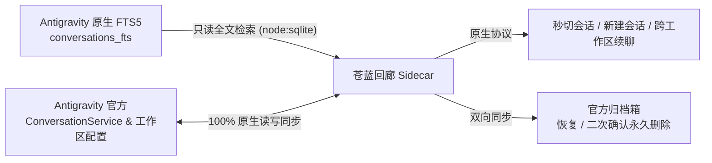

<div align="center">

<p>🌐 &nbsp; <strong>简体中文</strong> &nbsp;·&nbsp; <a href="README.en.md">English</a></p>

<picture>
  <source media="(prefers-color-scheme: dark)" srcset="assets/readme/hero-dark.svg">
  
</picture>

<p>
  <a href="https://github.com/A16Nights/antigravity-azure-corridor/releases"></a>
  <a href="https://github.com/A16Nights/antigravity-azure-corridor/stargazers"></a>
  
  
  
  <a href="./LICENSE"></a>
</p>

<p>
  <strong>100% 纯官方原生 Antigravity 2.35+ 会话与工作区同步管理 · FTS5 全文检索 · 跨工作区转移续聊 · 原生标签/分组与官方归档箱</strong>
</p>

<p>
  <a href="#preview">🖼️ 界面预览</a> &nbsp;·&nbsp; <a href="#features">✨ 功能全景</a> &nbsp;·&nbsp; <a href="#architecture">🧩 工作原理</a> &nbsp;·&nbsp; <a href="#installation">🚀 快速安装</a> &nbsp;·&nbsp; <a href="#storage">📂 数据存储</a> &nbsp;·&nbsp; <a href="#azure-suite">🌌 苍蓝全家桶</a>
</p>

</div>

面向 **Google Antigravity 2.35+** 的纯官方原生会话与工作区管理增强面板（Sidecar + 独立 Web UI）。100% 直连 Antigravity 官方 `ConversationService` 与工作区配置，并结合 `node:sqlite` 查询原生 `conversations_fts` 索引，实现毫秒级全文搜索、官方工作区聚合与新建、置顶/收藏/原生标签与官方分组、官方归档箱、批量操作、跨工作区转移续聊与官方永久删除。

<table>
<tr>
<td width="50%" valign="top">
<h4>⚡ 原生秒切 & FTS5 全文检索</h4>
基于 <code>node:sqlite</code> 直查原生 <code>conversations_fts</code> 索引，毫秒检索标题、正文与代码片段；点击会话通过官方原生协议秒切。
</td>
<td width="50%" valign="top">
<h4>🗂️ 100% 官方原生会话与工作区同步</h4>
直连官方 <code>ConversationService</code> 与工作区配置，实时同步官方工作区列表、分组、原生标签、置顶、收藏与官方归档状态。
</td>
</tr>
<tr>
<td width="50%" valign="top">
<h4>🔀 新建会话 & 跨工作区转移续聊</h4>
支持按指定工作区直接新建会话，并可将任意历史会话一键跨工作区转移续聊，工作上下文无缝衔接。
</td>
<td width="50%" valign="top">
<h4>📦 批量整理、官方归档箱与永久删除</h4>
开启批量管理后支持批量归档、分组、打标或清理；归档箱与官方原生归档完全双向同步，支持恢复或二次确认官方永久删除。
</td>
</tr>
</table>

<h2 id="preview">
<picture>
  <source media="(prefers-color-scheme: dark)" srcset="assets/readme/sec-preview-dark.svg">
  
</picture>
</h2>

<p align="center">
  <a href="assets/readme/preview-panel.png"></a>
  <br><strong>苍蓝回廊 · FTS5 全文检索、多维筛选与会话整理工作台</strong>
  <br><sub>毫秒级 FTS5 正文搜索、分组/标签/排序组合筛选、官方已归档同步徽标、行内改名与置顶/收藏/回看/归档操作</sub>
</p>

<h2 id="features">
<picture>
  <source media="(prefers-color-scheme: dark)" srcset="assets/readme/sec-features-dark.svg">
  
</picture>
</h2>

### 1. 原生会话秒切与多维 FTS5 全文检索
- **点击标题原生秒切**：通过 Antigravity Sidecar 原生 `toggle-conversation` 协议直接跳转并激活目标会话，搭配独立的「复制会话 ID」按钮。
- **FTS5 对话正文全文搜索**：基于 Node.js 内置 `node:sqlite` 直接查询 Antigravity 原生 `conversations_fts` 全文索引，毫秒级检索历史对话标题、正文与代码片段。
- **多维组合筛选与排序**：支持按全部会话、置顶、`★ 已收藏`、官方分组、原生标签、官方工作区与官方归档状态组合筛选与排序。

### 2. 100% 官方原生会话、工作区与分组双向同步
- **直连官方 `ConversationService`**：置顶、收藏、行内重命名、原生标签、官方分组、归档与恢复全部通过官方原生接口落盘，与 Antigravity 原生侧栏 100% 实时一致。
- **官方工作区聚合与新建会话**：自动读取本地已配置的官方工作区，支持按工作区聚合浏览，并在面板内直接向任意工作区新建会话。

### 3. 跨工作区转移续聊与批量管理
- **跨工作区转移续聊**：支持将已有会话一键转移到另一个目标工作区继续对话，告别换目录重新铺背景的烦恼。
- **批量整理与官方归档箱**：开启批量管理后支持多选批量分组、打标、收藏、归档或恢复；归档箱与官方归档完全同步，支持随时恢复或经二次确认执行官方永久删除。

### 4. 苍蓝统一视觉与交互体系
- **Neko Glass 毛玻璃界面**：支持深色 / 浅色双主题、自定义毛玻璃下拉框（`AzureSelect`）、7px 细圆角滚动条与切回面板静默刷新。
- **跨插件共享「苍蓝主题色调中心」**：内置 6 套官方配色预设 + 自定义主副双色取色器 + 4 个自定义保存栏位，与苍蓝全系插件实时联动。
- **左侧栏入口开关、独立 Web UI 与更新检查**：顶栏一键切换左侧栏快捷入口显隐、在系统浏览器全屏打开独立 `Web UI`、点击版本号实时检查 GitHub 最新 Release。

<h2 id="architecture">
<picture>
  <source media="(prefers-color-scheme: dark)" srcset="assets/readme/sec-arch-dark.svg">
  
</picture>
</h2>



<h2 id="installation">
<picture>
  <source media="(prefers-color-scheme: dark)" srcset="assets/readme/sec-install-dark.svg">
  
</picture>
</h2>

> **前置要求**：**Node.js >= 22.0.0**（零第三方 npm 运行时依赖，纯 Node.js 原生 ESM 实现）。

### 方式一 · 一句话让 Antigravity 帮你自动安装（推荐）

直接把下面这句话发给 Antigravity 即可自动完成克隆与核验：

> 帮我把 `https://github.com/A16Nights/antigravity-azure-corridor.git` 克隆到本机 Antigravity 全局插件目录，目录名设为 `azure-corridor`，检查目录无误后告诉我，我再按 `Ctrl+R` 重载生效。

### 方式二 · 命令行手动克隆

```powershell
# Windows (PowerShell)
git clone https://github.com/A16Nights/antigravity-azure-corridor.git "$env:USERPROFILE\.gemini\config\plugins\azure-corridor"

# macOS / Linux
git clone https://github.com/A16Nights/antigravity-azure-corridor.git ~/.gemini/config/plugins/azure-corridor
```

重启或重载 Antigravity（`Ctrl+R`），在 **Plugins** 面板启用 **苍蓝回廊** 即可在左侧栏或右侧辅助面板打开。

<h2 id="storage">
<picture>
  <source media="(prefers-color-scheme: dark)" srcset="assets/readme/sec-storage-dark.svg">
  
</picture>
</h2>

<details open>
<summary><strong>点击展开查看本机数据目录与苍蓝套件共享配置路径</strong></summary>

<br>

- **回廊轻量界面偏好**：`~/.gemini/azure-corridor/`（会话元数据、分组、标签与归档全部直连 Antigravity 官方原生存储，无需维护平行影子库）
- **苍蓝套件左侧栏显示配置**：`~/.gemini/azure-sidebar-nav.json`
- **苍蓝套件共享主题配置**：`~/.gemini/azure-theme.json`

</details>

<h2 id="azure-suite">
<picture>
  <source media="(prefers-color-scheme: dark)" srcset="assets/readme/sec-suite-dark.svg">
  
</picture>
</h2>

**苍蓝套件（Azure Suite）** 9 款插件共享统一的 **Neko Glass 毛玻璃界面**、跨插件同步的 **苍蓝主题色调中心**（`~/.gemini/azure-theme.json`）以及可自由开关的 **左侧栏快捷入口**（`~/.gemini/azure-sidebar-nav.json`）：

| 插件 | 仓库 | 核心能力 |
| --- | --- | --- |
| ✦ **苍蓝协奏台** | [antigravity-external-orchestrator](https://github.com/A16Nights/antigravity-external-orchestrator) | 多渠道外部模型协同调度、自定义调度角色、容灾断路器与全链路实时监控 |
| 🪐 **苍蓝星轨** | [antigravity-azure-orbit](https://github.com/A16Nights/antigravity-azure-orbit) | 将外部大模型直接挂载进 Antigravity 左下角原生模型下拉菜单担任主脑 |
| 🧭 **苍蓝罗盘** | [antigravity-azure-compass](https://github.com/A16Nights/antigravity-azure-compass) | Agent 工作模式预设中心、上下文水位监测与自动 /compact、苍蓝套件左侧栏总控 |
| 🏛️ **苍蓝回廊** &nbsp;`✦ 当前仓库` | [antigravity-azure-corridor](https://github.com/A16Nights/antigravity-azure-corridor) | 只读原生会话 FTS5 全文检索、自定义项目分组、优先级标签与独立安全归档箱 |
| 🌌 **蓝汐 · 潮汐认知图谱** | [antigravity-lanxi-memory](https://github.com/A16Nights/antigravity-lanxi-memory) | 五层纯 Markdown 真源记忆、CJK FTS5、潮汐遗忘曲线与交互式潮汐星海图谱 |
| 💎 **苍蓝魂匣** | [antigravity-soul-md](https://github.com/A16Nights/antigravity-soul-md) | 多人设卡热切换、工作区专属绑定、外接模型智能防掉线锚点与分层文件记忆 |
| 💭 **思语中文** | [antigravity-think-zh](https://github.com/A16Nights/antigravity-think-zh) | 内部思考语言简体中文 / 英文双档热切换、双通道防漂移与实时注入预览 |
| 🔮 **苍蓝棱镜** | [antigravity-azure-prism](https://github.com/A16Nights/antigravity-azure-prism) | 原生 MCP App 思维链实时观测、免密钥零 Token 机翻与外部模型双通道译文 |
| 🪄 **苍蓝魔杖** | [antigravity-azure-wand](https://github.com/A16Nights/antigravity-azure-wand) | Windows 桌面与网页低打扰操控台、独立输入 15 状态 AI 光标、套装画廊混搭与外部光标导入 |

---

<div align="center">

📄 Released under the <a href="./LICENSE"><strong>MIT License</strong></a> · Crafted for <strong>Google Antigravity</strong>

</div>
