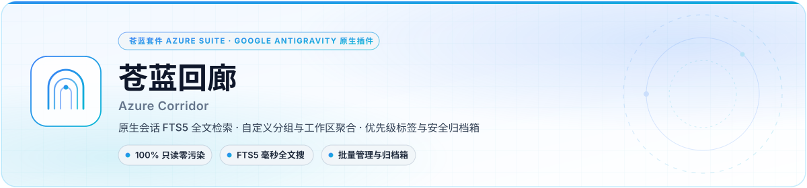
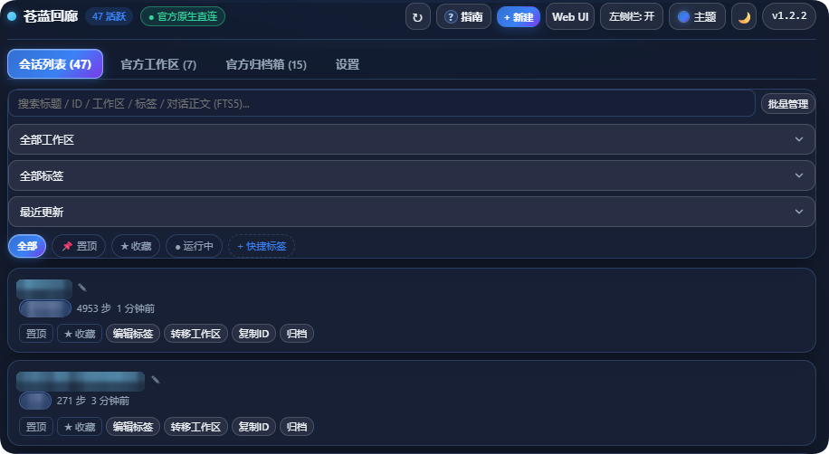
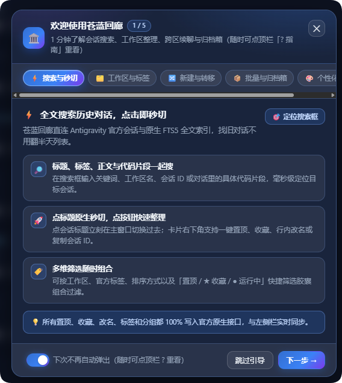
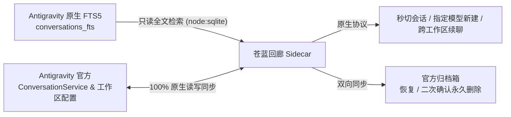

<div align="center">

<p>🌐 &nbsp; <strong>简体中文</strong> &nbsp;·&nbsp; <a href="README.en.md">English</a></p>

<picture>
  <source media="(prefers-color-scheme: dark)" srcset="assets/readme/hero-dark.svg">
  
</picture>

<p>
  <a href="https://github.com/A16Nights/antigravity-azure-corridor/releases"></a>
  <a href="https://github.com/A16Nights/antigravity-azure-corridor/stargazers"></a>
  
  
  
  <a href="./LICENSE"></a>
</p>

<p>
  <strong>苍蓝回廊——会话与工作区管理 · 100% 纯官方原生同步 · FTS5 全文检索 · 自选快捷标签栏 · 跨工作区转移续聊 · 首次新手引导</strong>
</p>

<p>
  <a href="#preview">🖼️ 界面预览</a> &nbsp;·&nbsp; <a href="#features">✨ 功能全景</a> &nbsp;·&nbsp; <a href="#architecture">🧩 工作原理</a> &nbsp;·&nbsp; <a href="#installation">🚀 快速安装</a> &nbsp;·&nbsp; <a href="#storage">📂 数据存储</a> &nbsp;·&nbsp; <a href="#azure-suite">🌌 苍蓝全家桶</a>
</p>

</div>

**苍蓝回廊——会话与工作区管理**（Azure Corridor）是面向 **Google Antigravity 2.35+** 的纯官方原生会话与工作区管理增强面板（Sidecar + 独立 Web UI）。100% 直连 Antigravity 官方 `ConversationService` 与工作区配置，并结合 `node:sqlite` 查询原生 `conversations_fts` 索引，提供毫秒级全文搜索、官方工作区聚合与新建、自选快捷标签筛选栏、指定官方具体模型新建/跨工作区转移续聊、批量整理、官方归档箱、二次确认官方永久删除，以及开箱即用的 5 步交互式首次新手引导。

<table>
<tr>
<td width="50%" valign="top">
<h4>⚡ 原生秒切 &amp; FTS5 全文检索</h4>
基于 <code>node:sqlite</code> 直查原生 <code>conversations_fts</code> 索引，毫秒检索标题、标签、正文与代码片段；点击标题通过官方原生协议秒切会话。
</td>
<td width="50%" valign="top">
<h4>🏷️ 100% 官方原生同步 &amp; 自选快捷标签栏</h4>
直连官方 <code>ConversationService</code> 与工作区配置，实时同步置顶、收藏、原生标签与官方归档；常用 <code>#标签</code> 可钉选到顶部快捷筛选栏一键直达。
</td>
</tr>
<tr>
<td width="50%" valign="top">
<h4>🔀 指定官方模型新建 &amp; 跨工作区转移续聊</h4>
实时拉取本机可用官方具体模型，默认自动沿用原会话或当前活跃对话的模型；一键把历史会话带上下文转移到目标工作区无缝续聊。
</td>
<td width="50%" valign="top">
<h4>🧭 5 步交互新手引导 &amp; 官方归档箱</h4>
首次打开自动弹出交互式教程，支持「定位到界面」实时脉冲高亮控件，顶栏 <code>? 指南</code> 随时重看；批量整理与归档箱 100% 同步官方。
</td>
</tr>
</table>

<h2 id="preview">
<picture>
  <source media="(prefers-color-scheme: dark)" srcset="assets/readme/sec-preview-dark.svg">
  
</picture>
</h2>

<p align="center">
  <a href="assets/readme/preview-panel.png"></a>
  <br><strong>苍蓝回廊——会话与工作区管理 · 主界面工作台</strong>
  <br><sub>FTS5 毫秒全文搜索、工作区/标签/排序组合筛选、「全部 / 置顶 / 收藏 / 运行中 / + 快捷标签」自选标签筛选栏、卡片快捷编辑标签与转移工作区</sub>
</p>

<p align="center">
  <a href="assets/readme/preview-onboarding.png"></a>
  <br><strong>首次使用 5 步交互式新手引导弹窗</strong>
  <br><sub>分步介绍核心用法、支持点击「定位搜索框 / 快捷标签 / 新建按钮」在页面上脉冲高亮真实控件，并支持顶栏 <code>? 指南</code> 随时重看</sub>
</p>

<h2 id="features">
<picture>
  <source media="(prefers-color-scheme: dark)" srcset="assets/readme/sec-features-dark.svg">
  
</picture>
</h2>

### 1. 原生会话秒切、FTS5 全文检索与自选快捷标签栏
- **点击标题原生秒切**：通过 Antigravity Sidecar 原生 `toggle-conversation` 协议直接跳转并激活目标会话，搭配行内改名与「复制 ID」快捷按钮。
- **FTS5 对话正文全文搜索**：基于 Node.js 内置 `node:sqlite` 直接查询 Antigravity 原生 `conversations_fts` 全文索引，毫秒级检索历史对话标题、标签、正文与代码片段。
- **自选快捷标签筛选栏**：在「全部 / 📌 置顶 / ★ 收藏 / ● 运行中」快捷行末尾点击 **`+ 快捷标签`**，即可挑选常用官方标签（或直接新建标签）钉选成顶部快捷胶囊，一键切换并可叠加置顶/收藏筛选；点击会话卡片里的任意 `#标签` 徽章也能直接按该标签筛选。

### 2. 100% 官方原生会话与工作区双向同步
- **直连官方 `ConversationService`**：置顶、收藏、行内重命名、原生标签、归档与恢复全部直接写入官方原生接口，与 Antigravity 原生侧栏 100% 实时一致；聚焦「工作区 + 标签」高频整理路径，避免多余概念干扰（历史分组字段保留在编辑弹窗默认折叠的高级兼容项中）。
- **官方工作区聚合与新建会话**：自动读取本地已配置的官方工作区，支持按工作区聚合浏览每个项目的活跃会话，并在面板内直接向任意工作区新建会话。

### 3. 跨工作区增强续聊、零 LLM 抢救简报与自动沿用当前模型
- **跨工作区增强交接续聊**：支持将已有会话一键转移到另一个目标工作区继续对话，自动继承标题、标签、置顶/收藏，并零 LLM 提取近期诉求、修改文件列表、校验线索与最后进展塞入交接消息，可选自动归档旧会话。
- **零 LLM 脱敏「🛟 抢救简报」**：任意活跃或归档会话卡片均支持一键提取本地脱敏 Markdown 抢救简报（`<20ms`，含模型、实测 Token/缓存率、改动文件与最近进展，自动脱敏常见密钥/Token），支持一键复制或 **「✨ 带简报新建会话」** 无缝抢救卡死/爆窗对话。
- **实时官方具体模型选择 & 默认沿用当前模型**：新建会话与跨工作区转移续聊均实时拉取本机 Antigravity 官方具体模型列表（同时保留通用档位兜底），默认项自动识别并沿用原会话或当前活跃对话正在使用的官方模型，避免创建后被回退到默认档位。
- **批量整理与官方归档箱**：开启「批量管理」后支持多选批量置顶、收藏、打标签、归档或恢复；归档箱与官方归档完全同步，支持随时恢复或经二次确认执行官方永久删除。

### 4. 首次使用交互式新手引导与苍蓝统一界面
- **5 步交互式新手引导（`? 指南`）**：首次打开自动展示 5 步功能引导，点击每步右上角的「🎯 定位到界面」按钮可在面板中实时脉冲高亮对应的真实控件并附带浮动返回条；已读状态持久化至本机 JSON（跨重启换端口不复弹），也可随时点顶栏 **`? 指南`** 重看。
- **Neko Glass 毛玻璃界面与跨插件主题联动**：支持深色 / 浅色双主题、跨插件共享「苍蓝主题色调中心」（6 套官方配色 + 自定义双色 + 4 个自定义保存槽）、顶栏左侧栏入口开关、独立 `Web UI` 与点击版本号实时检查 GitHub 最新 Release。

<h2 id="architecture">
<picture>
  <source media="(prefers-color-scheme: dark)" srcset="assets/readme/sec-arch-dark.svg">
  
</picture>
</h2>



<h2 id="installation">
<picture>
  <source media="(prefers-color-scheme: dark)" srcset="assets/readme/sec-install-dark.svg">
  
</picture>
</h2>

> **前置要求**：**Node.js >= 22.0.0**（零第三方 npm 运行时依赖，纯 Node.js 原生 ESM 实现）。

### 方式一 · 一句话让 Antigravity 帮你自动安装（推荐）

直接把下面这句话发给 Antigravity 即可自动完成克隆与核验：

> 帮我把 `https://github.com/A16Nights/antigravity-azure-corridor.git` 克隆到本机 Antigravity 全局插件目录，目录名设为 `azure-corridor`，检查目录无误后告诉我，我再按 `Ctrl+R` 重载生效。

### 方式二 · 命令行手动克隆

```powershell
# Windows (PowerShell)
git clone https://github.com/A16Nights/antigravity-azure-corridor.git "$env:USERPROFILE\.gemini\config\plugins\azure-corridor"

# macOS / Linux
git clone https://github.com/A16Nights/antigravity-azure-corridor.git ~/.gemini/config/plugins/azure-corridor
```

重启或重载 Antigravity（`Ctrl+R`），在 **Plugins** 面板启用 **苍蓝回廊——会话与工作区管理** 即可在左侧栏或右侧辅助面板打开。

<h2 id="storage">
<picture>
  <source media="(prefers-color-scheme: dark)" srcset="assets/readme/sec-storage-dark.svg">
  
</picture>
</h2>

<details open>
<summary><strong>点击展开查看本机数据目录与苍蓝套件共享配置路径</strong></summary>

<br>

- **回廊轻量界面偏好（含自选快捷标签）**：`~/.gemini/azure-corridor/prefs.json`（会话元数据、标签与归档全部直连 Antigravity 官方原生存储，无需维护平行影子库）
- **首次新手引导已读状态**：`~/.gemini/azure-onboarding.json`
- **苍蓝套件左侧栏显示配置**：`~/.gemini/azure-sidebar-nav.json`
- **苍蓝套件共享主题配置**：`~/.gemini/azure-theme.json`

</details>

<h2 id="azure-suite">
<picture>
  <source media="(prefers-color-scheme: dark)" srcset="assets/readme/sec-suite-dark.svg">
  
</picture>
</h2>

**苍蓝套件（Azure Suite）** 11 款插件共享统一的 **Neko Glass 毛玻璃界面**、跨插件同步的 **苍蓝主题色调中心**（`~/.gemini/azure-theme.json`）以及可自由开关的 **左侧栏快捷入口**（`~/.gemini/azure-sidebar-nav.json`）：

| 插件 | 仓库 | 核心能力 |
| --- | --- | --- |
| ✦ **苍蓝协奏台——外部模型调度与省流** | [antigravity-external-orchestrator](https://github.com/A16Nights/antigravity-external-orchestrator) | 多渠道外部模型协同调度、自定义调度角色、容灾断路器与全链路实时监控 |
| 🪐 **苍蓝星轨——原生菜单外接模型挂载** | [antigravity-azure-orbit](https://github.com/A16Nights/antigravity-azure-orbit) | 将外部大模型直接挂载进 Antigravity 左下角原生模型下拉菜单担任主脑 |
| 🧭 **苍蓝罗盘——Agent 预设与上下文监控** | [antigravity-azure-compass](https://github.com/A16Nights/antigravity-azure-compass) | Agent 工作模式预设中心、上下文水位监测与自动 /compact、苍蓝套件左侧栏总控 |
| 🏛️ **苍蓝回廊——会话与工作区管理** &nbsp;`✦ 当前仓库` | [antigravity-azure-corridor](https://github.com/A16Nights/antigravity-azure-corridor) | 纯官方原生会话与工作区同步、FTS5 全文检索、自选快捷标签栏、跨工作区转移续聊、官方模型选择与交互式新手引导 |
| 🌌 **蓝汐——认知图谱长期记忆** | [antigravity-lanxi-memory](https://github.com/A16Nights/antigravity-lanxi-memory) | 五层纯 Markdown 真源记忆、CJK FTS5、潮汐遗忘曲线与交互式潮汐星海图谱 |
| 💎 **苍蓝魂匣——人设卡与分层记忆** | [antigravity-soul-md](https://github.com/A16Nights/antigravity-soul-md) | 多人设卡热切换、工作区专属绑定、外接模型智能防掉线锚点与分层文件记忆 |
| 💭 **思语中文——外接模型中文思考切换** | [antigravity-think-zh](https://github.com/A16Nights/antigravity-think-zh) | 内部思考语言简体中文 / 英文双档热切换、双通道防漂移与实时注入预览 |
| 🔮 **苍蓝棱镜——思维链观测与实时翻译** | [antigravity-azure-prism](https://github.com/A16Nights/antigravity-azure-prism) | 原生 MCP App 思维链实时观测、免密钥零 Token 机翻与外部模型双通道译文 |
| 🪄 **苍蓝魔杖——Windows 桌面与网页操控** | [antigravity-azure-wand](https://github.com/A16Nights/antigravity-azure-wand) | Windows 桌面与网页低打扰操控台、独立输入 15 状态 AI 光标、套装画廊混搭与外部光标导入 |
| 🍃 **苍蓝流笺——拖拽发图与原生文件标签** | [antigravity-azure-drop](https://github.com/A16Nights/antigravity-azure-drop) | 零 `app.asar` 侵入、拖拽与粘贴插入原生文件标签、无损 PNG 截图落盘、图片缩略图灯箱与顶栏面包屑右键菜单 |
| 🔭 **苍蓝星瞳——多账号 Gemini 网页副脑** &nbsp;`Beta` | [antigravity-azure-lens](https://github.com/A16Nights/antigravity-azure-lens) | 1:1 原生双态 Gemini 侧栏、双标签物理隔离、多账号独立 Profile 自动检测、免跳转内部弹窗与 MCP 静默调研审阅 |

---

<div align="center">

📄 Released under the <a href="./LICENSE"><strong>MIT License</strong></a> · Crafted for <strong>Google Antigravity</strong>

</div>
